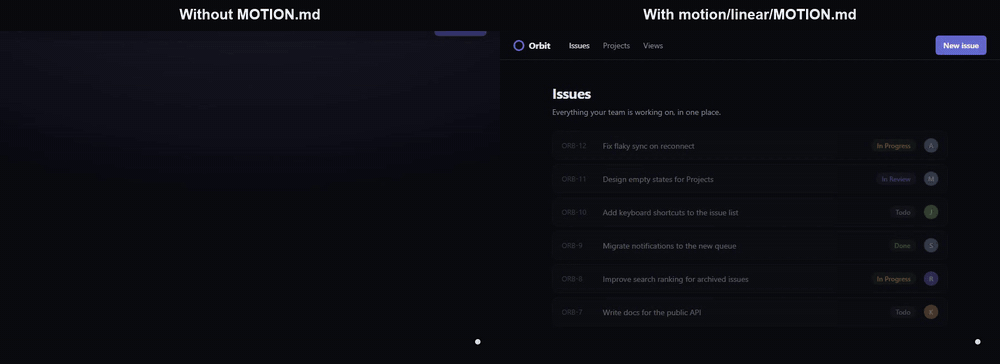

# awesome MOTION.md

**Your agent animates everything at 300ms `ease-in-out` and fades every card up.
Real products don't. Drop a MOTION.md into your project and it animates like Linear.**



Both builds come from the same agent (Claude Sonnet) and the same prompt
([`demo/PROMPT.md`](demo/PROMPT.md)). The right one was also told to follow
[`motion/linear/MOTION.md`](motion/linear/MOTION.md). We then measured both with the
extractor that measured linear.app:

| | Without MOTION.md | With linear/MOTION.md | linear.app (measured) |
|---|---|---|---|
| Distinct durations | 7 | 2 | 6 |
| Top durations | 180ms, 220ms, 200ms | 160ms (61%), 100ms (39%) | 100ms (52%), 160ms (36%) |
| Top curve | `ease` (69%) | easeOutQuad (100%) | easeOutQuad (77%) |
| Transitions on `transform` | 31% | 3% | 12% |
| Transitions on `box-shadow` | 18% | 0% | 2% |
| Load stagger | 60ms fade-up | none | 33ms headline (plus a 144ms marquee) |
| motionlint findings | 1 | 0 | n/a |

Full table: [`demo/RESULTS.md`](demo/RESULTS.md). To reproduce it, run `npm run demo`.

## What is MOTION.md?

[DESIGN.md](https://github.com/VoltAgent/awesome-design-md) tells an agent how a
product looks. It says almost nothing about how the product moves: in that collection,
34 of 84 files never mention transition, animation, easing, duration or motion, and
only 2 contain a `cubic-bezier`.

| File | Defines |
|---|---|
| `AGENTS.md` / `CLAUDE.md` | How to build the project |
| `DESIGN.md` | How it looks |
| **`MOTION.md`** | **How it moves** |

A MOTION.md has duration and easing tokens, a pattern for each element (hover,
enter, exit, page load, scroll, stagger, loops), a **Never** list, and the reduced-motion
behaviour. Every number comes from **measuring the live site**, not from what
someone remembers: computed styles, `transitionrun` events, `Element.animate()`
calls, `getAnimations()` samples, and inline-style writes from JS animation libraries.
Spec: [FORMAT.md](FORMAT.md).

## The collection

Measured on 2026-10-29 in Chromium 156 at 1440×900, 2 pages per brand.

| Brand | Durations | Main curve | Hover moves things? | File |
|---|---|---|---|---|
| Linear | 100ms 50%, 160ms 38% | easeOutQuad 77% | 3 of 33 probes | [MOTION.md](motion/linear/MOTION.md) |
| Stripe | 300ms (home), 150ms (/payments) | `cubic-bezier(0.25, 1, 0.5, 1)` on home, easeOutCubic on /payments | 23 of 35, mostly arrow glyphs and layers inside cards | [MOTION.md](motion/stripe/MOTION.md) |
| Apple | 320ms 39%, 240ms 30% | `ease` 56% | 9 of 32 | [MOTION.md](motion/apple/MOTION.md) |
| Vercel | 100ms 63%, 150ms 34% | `cubic-bezier(0.4, 0, 0.2, 1)` 98% | 0 of 13 | [MOTION.md](motion/vercel/MOTION.md) |
| Framer¹ | 400 / 600 / 1000ms, all JS | critically damped spring as `linear()` | 9 of 9, all JS | [MOTION.md](motion/framer/MOTION.md) |
| The Browser Company² (Arc, Dia) | 200ms 82% | `cubic-bezier(0.4, 0, 0.2, 1)` 82% | 3 CSS + 7 JS of 12 | [MOTION.md](motion/arc/MOTION.md) |
| Raycast | 200ms, 300ms on the UI | `ease` on the UI³ | 4 of 14 | [MOTION.md](motion/raycast/MOTION.md) |
| Airbnb | 300 / 200 / 100 / 250ms | `cubic-bezier(0.2, 0, 0, 1)` 93% | 0 of 14 | [MOTION.md](motion/airbnb/MOTION.md) |

¹ framer.com/motion now redirects to motion.dev, so the Framer file uses framer.com only.
framer.com declares one CSS transition; its motion is JS springs.
² arc.net is now a farewell letter; most of the measured UI is Dia (diabrowser.com).
³ 980 of Raycast's 1,352 homepage transitions are easeOutQuint at 400ms on one keyboard
illustration (none on /pro). The file treats that as illustration, not UI.

What all eight have in common, which is the opposite of default AI motion:

- **None of them smooth-scroll.** On all 16 pages, one wheel tick settled in under a frame.
- **None apply a bouncy `cubic-bezier`** to a transition. Overshoot is either absent or a
  `linear()` spring.
- **`transition: all` is rare**, at 0–2% of declared transitions (one per property per
  element) on 13 of 16 pages.
- **Hover is mostly a colour change.** Linear, Vercel and Airbnb moved an element on
  3 of 33, 0 of 13 and 0 of 14 hover probes. Stripe is the exception (23 of 35), and
  even there the card itself stays put: only the arrow glyph and inner layers move.

## Install

Copy one file into your project root:

```bash
curl -o MOTION.md https://raw.githubusercontent.com/dadwritestech/awesome-motion-md/main/motion/linear/MOTION.md
```

Then tell your agent, or add this line to `AGENTS.md` / `CLAUDE.md`:

```text
Follow MOTION.md for every transition and animation. Use its tokens; obey its Never list.
```

### Claude Code skill

The skill makes Claude Code read MOTION.md before writing any motion and lint the
result afterwards:

```bash
git clone https://github.com/dadwritestech/awesome-motion-md
cp -r awesome-motion-md/skill/motion-md ~/.claude/skills/
```

## motionlint: catch AI motion tells

A zero-dependency, deterministic linter for CSS, HTML, JSX/TSX, Vue, Svelte and
Astro. It reads CSS, Tailwind classes, Framer Motion props and GSAP calls.

```bash
node lint/motionlint.mjs src/            # exit 2 when warnings are found
node lint/motionlint.mjs src/ --json
node lint/motionlint.mjs --list-rules
```

| Rule | Catches |
|---|---|
| `uniform-timing` | One duration + curve on most of the project (the 300ms `ease-in-out` default) |
| `keyword-easing-only` | No authored curve anywhere, only `ease` / `ease-in-out` / `linear` |
| `fade-up-everything` | Opacity 0 + translateY up on many elements (keyframes, Framer `initial`, AOS, Tailwind, GSAP `from`) |
| `bounce-everywhere` | Overshoot curves, bounce keyframes and bouncy springs on many elements |
| `hover-lift-everywhere` | Scale-up, lift or big shadow on hover on many elements |
| `transition-all` | `transition: all` and Tailwind `transition-all` |
| `animating-layout` | Transitions on width, height, top, margin… |
| `no-reduced-motion` | Motion with no `prefers-reduced-motion` handling |
| `sluggish-feedback` | Colour feedback slower than 400ms |
| `ease-in-out-ui`, `overshoot-easing`, `slow-stagger`, `ambient-loop` | Advisories |

Silence a line with `/* motionlint-disable-next-line rule */`, or a file with
`/* motionlint-disable rule */`. The thresholds are explained in each rule's hint.

## Measure your own site

```bash
npm install
npx playwright install chromium
# add { "id": "mysite", "name": "My site", "urls": ["https://..."] } to extract/brands.json
node extract/extract.mjs mysite        # → data/raw/mysite.json
node extract/summarize.mjs mysite      # → data/mysite.summary.json
node extract/generate.mjs mysite       # → motion/mysite/MOTION.draft.md
```

The draft has the tokens and a Measurements section. Write the prose by hand: the
extractor cannot tell an illustration loop from a UI loop, and it cannot tell whether
an overshoot curve in the CSS is ever applied. Every brand file here was edited by
hand to make those calls.

**What the extractor sees:** declared transitions on up to 6,000 elements; transitions
and animations that actually ran, by phase (load, hover in and out, scroll); WAAPI
calls with keyframes; JS-library motion through inline-style writes; smooth-scroll
hijacking; and a second load with `prefers-reduced-motion: reduce`.
**What it does not see:** anything behind a login, menus and dialogs that never
opened, and touch gestures.

## Related

- [2233admin/motion.md](https://github.com/2233admin/motion.md) is a different format
  with the same file name. It describes an app's motion as a state machine. The two
  fit together: take curves and durations from a brand file here, and put them into
  that spec. See [COMPETITION.md](COMPETITION.md).
- [VoltAgent/awesome-design-md](https://github.com/VoltAgent/awesome-design-md) for DESIGN.md.
- [pbakaus/impeccable](https://github.com/pbakaus/impeccable): the overshoot threshold
  in motionlint comes from its `bounce-easing` rule.

## Disclaimer

Unofficial. These files describe publicly visible motion on each company's marketing
site, measured on one date. They are not affiliated with or endorsed by Linear,
Stripe, Apple, Vercel, Framer, The Browser Company, Raycast or Airbnb. All trademarks
belong to their owners.

## License

- **MOTION.md files and data** (`motion/`, `data/`, `FORMAT.md`): [CC BY 4.0](LICENSE-CONTENT).
- **Extractor, linter, skill and demo:** [MIT](LICENSE).
- Brand names belong to their owners; the files describe publicly observable motion, with no affiliation.
